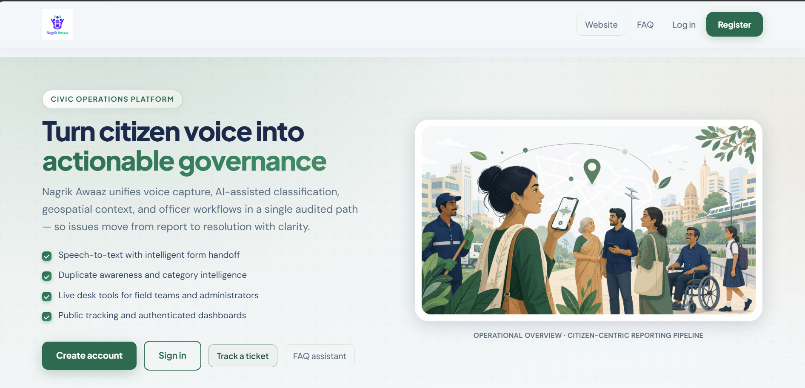
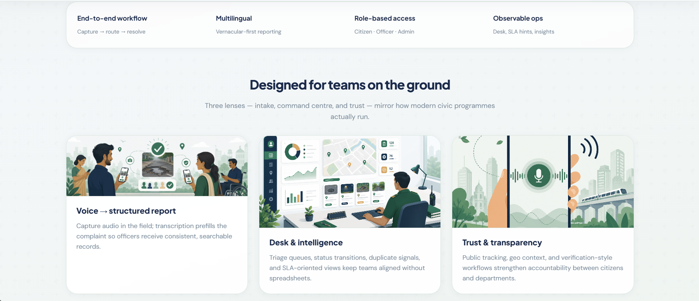
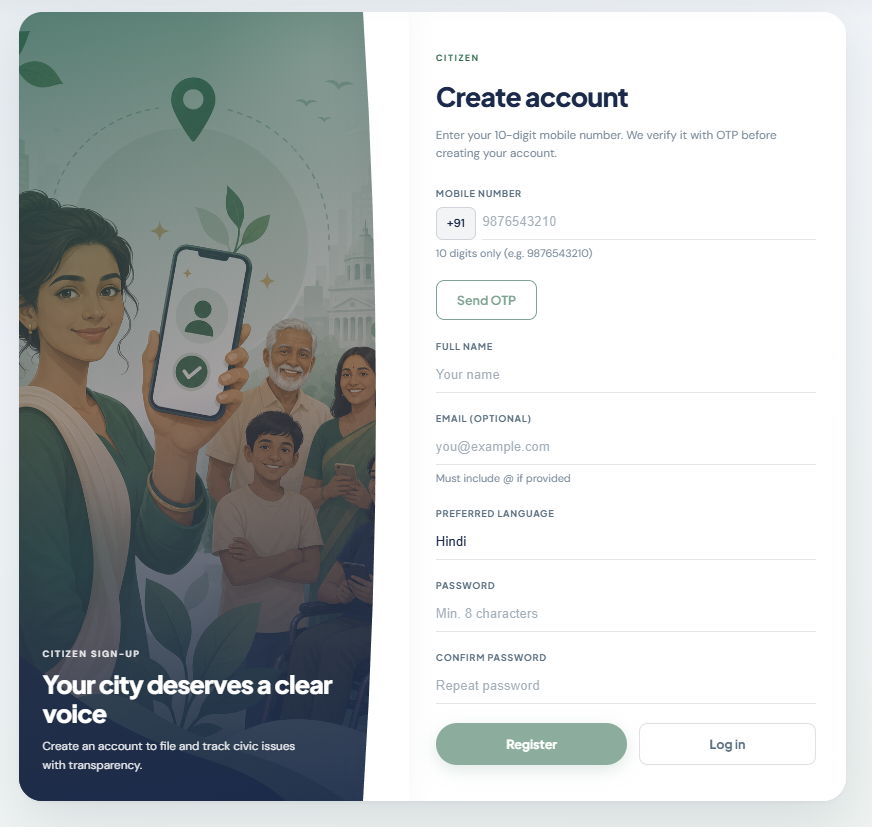
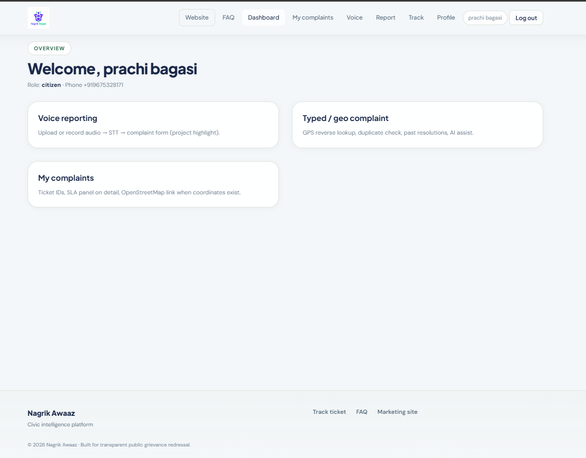
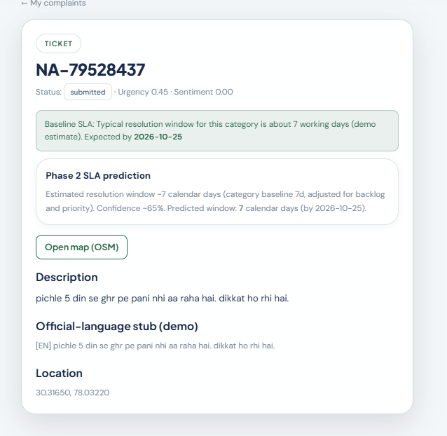
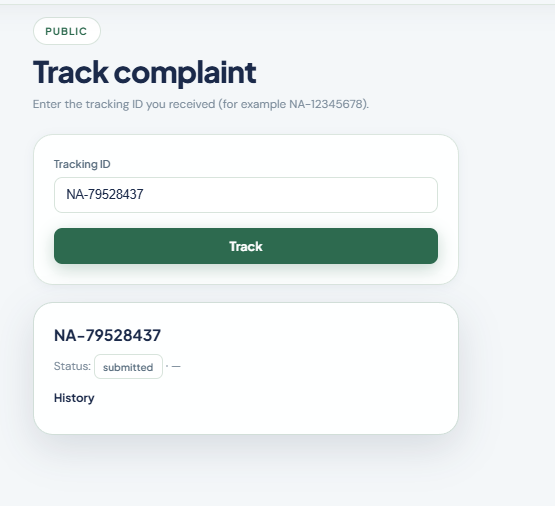
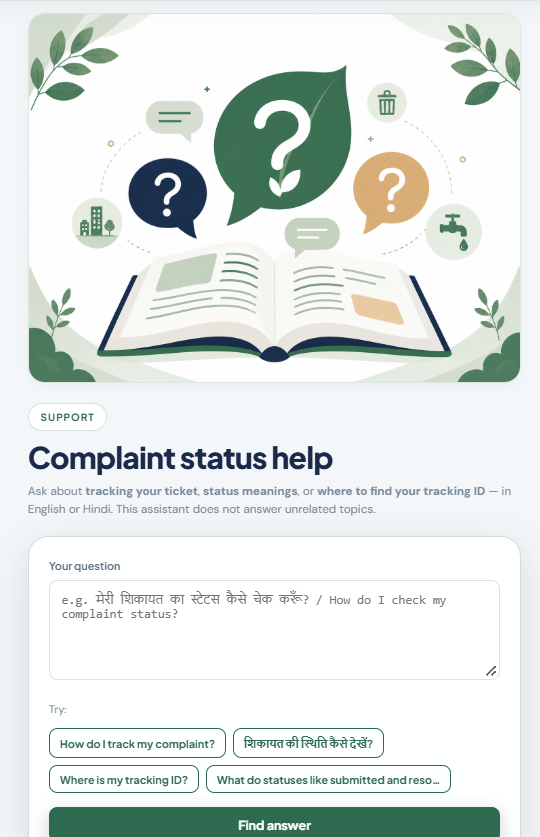

# Nagrik Aawaz (नागरिक आवाज़)

**Nagrik Aawaz** ("Citizen's Voice") is a civic complaint-management platform that lets citizens report public-service issues — electricity, water, roads/PWD, education, and more — by text or voice, in multiple Indian languages, and track them through to resolution.

A Django REST API powers authentication, complaint workflows, AI-assisted triage, and notifications; a React (Vite) single-page app is the primary citizen-facing client. The repo also includes standalone department micro-sites and an experimental complaint-drafting agent.

This was built as a **4th-year group major project**. It's shared here to showcase the work — some parts are still being refined (see [Project Status](#project-status)).

## Images








## Features

- **Phone + OTP authentication** with JWT sessions (citizen, field officer, and admin roles)
- **Complaint lifecycle** — submit, track (via a human-readable tracking ID), assign, resolve, close — with status, priority, SLA due dates, and geolocation
- **Voice complaints** — record in Hindi, English, Tamil, or Marathi; transcribed with OpenAI Whisper and auto-translated
- **AI triage (Agent1)** — rule-based/ML category classification, urgency scoring, and optional LLM-drafted formal complaint text (via Groq)
- **Phase 2 intelligence** — near-duplicate clustering, sentiment scoring, community verification counts, and auto-assignment
- **Notifications** — SMS (Twilio) and push (Firebase Cloud Messaging) delivery on status changes
- **Department portals** — standalone HTML/CSS/JS complaint mini-sites for Bijli Vibhag (electricity), Jal Vibhag (water), Shiksha Vibhag (education), and PWD
- **IVR stub** — inbound endpoint for phone-based complaint intake

## Tech Stack

| Layer | Technology |
|---|---|
| Backend | Django 5, Django REST Framework, SimpleJWT, django-filter |
| Database | SQLite (dev) / PostgreSQL (prod, via `psycopg`) |
| AI / ML | scikit-learn, pandas, TextBlob, Groq LLM API |
| Voice | OpenAI Whisper, FFmpeg (via `imageio-ffmpeg`) |
| Frontend | React 19, Vite, React Router |
| Notifications | Twilio (SMS), Firebase (push) |
| Testing | pytest, pytest-django, factory-boy |

## Project Structure

```
apps/
  accounts/       Auth, users, OTP verification
  complaints/     Complaint model, workflow, Phase 2 intelligence
  voice/          Voice upload + Whisper transcription
  ai_ml/          Agent1 classification, translation, LLM drafting
  departments/    Department metadata & file storage
  notifications/  SMS / push delivery
  core/           Shared middleware, permissions, health check
config/           Django settings (base / development / production), URLs
src/              React frontend (pages, components, API client, context)
complaint_agent/  Standalone experimental complaint-drafting script
Bijli_vibhag/     Electricity department complaint mini-site
jal vibhag/       Water department complaint mini-site
shiksha_vibhag/   Education department complaint mini-site
pwd/              Public Works Department complaint mini-site
tests/            Backend test suite (pytest)
```

## Project Status

This project was built as a college major project and is under active improvement. Core flows (auth, complaint submission, voice-to-text, classification) work end-to-end, but some edge cases and integrations are still being hardened. Known areas of ongoing work:

- Classifier accuracy on mixed-language / code-switched text (Hinglish, transliterated regional languages)
- Broader training data for the Naive Bayes model beyond the current seed categories
- Error handling around the Whisper/Groq fallback paths when API keys are unset

Contributions, issues, and suggestions are welcome.

## My Contribution — Text Classification (Agent1)

I was responsible for the **text classification pipeline** that takes a citizen's complaint (typed or transcribed from voice) and automatically routes it to the correct department and issue sub-category, so it reaches the right authority without manual sorting.

**What it does** (`apps/ai_ml/services/`):

- **Speech-to-text**: Voice complaints are transcribed using **OpenAI Whisper** (`stt_whisper.py`), with language hints for Hindi, Tamil, Marathi, and other Indian languages, and FFmpeg-based audio preprocessing so it works without a system FFmpeg install.
- **Translation & drafting via Groq**: Non-English/mixed-language complaint text is translated to English through the **Groq LLM API** (`agent1_translator.py`), and a formal, government-style complaint letter is optionally drafted from the citizen's raw text (`agent1_draft.py`), with a deterministic template as a fallback whenever no `GROQ_API_KEY` is configured.
- **Category & sub-category classification**: The translated text is vectorized with **TF-IDF** and classified using **Multinomial Naive Bayes** (`agent1_classifier.py`) into a department (Electricity, Water, PWD, Education, …) and a specific sub-category (e.g. "Voltage Issue", "Pipe Leakage / Burst", "Road Pothole"). A keyword-based rule layer runs alongside the ML model to catch clear cases and keep sub-categories consistent with their parent department.
- **Priority scoring**: A lightweight urgency heuristic (keyword triggers + sentiment polarity via TextBlob) tags each complaint as Low/Medium/High priority.
- **Training data & routing config**: `training_data.py` and `agent1_config.py` define the category/sub-category taxonomy per department and the authority each category is routed to.

**Status**: The rule-based routing and Naive Bayes classifier are functional and integrated into the complaint submission flow. I'm actively working on improving classification accuracy for mixed-language input and expanding the training dataset — this is shared now to have something concrete to demo while that work continues.

## Getting Started

### Prerequisites

- Python 3.10+ (3.11–3.13 recommended)
- Node.js 18+ and npm
- FFmpeg is bundled via `imageio-ffmpeg`, so no separate system install is needed for voice transcription

### Backend setup

```bash
# from the project root
python -m venv venv
source venv/bin/activate        # Windows: venv\Scripts\activate

pip install -r requirements.txt # installs requirements/development.txt

# create a .env file in the project root with at least:
#   SECRET_KEY=your-secret-key
# (see Environment Variables below for optional settings)

python manage.py migrate
python scripts/seed_categories.py   # seed complaint categories
python manage.py createsuperuser
python manage.py runserver          # http://127.0.0.1:8000
```

### Frontend setup

```bash
npm install
cp .env.example .env.local
npm run dev                          # http://127.0.0.1:5173
```

`npm run dev` proxies `/api` requests to `http://127.0.0.1:8000`. Set `VITE_BACKEND_URL` in `.env.local` if your backend runs elsewhere.

### Department demo portals

In a third terminal, serve the standalone department sites used by Agent1's **Open department portal** action:

```powershell
python scripts/serve_department_portals.py  # http://127.0.0.1:5500
```

This server binds to localhost and serves only the four department-site folders. The Nagrik Aawaz API's **Submit to department API** action uses Django directly and does not depend on this static server.

### Running tests

```bash
pytest
```

## Environment Variables

Backend (`.env` in project root):

| Variable | Required | Default | Purpose |
|---|---|---|---|
| `SECRET_KEY` | Yes | — | Django secret key |
| `ALLOWED_HOSTS` | No | `localhost,127.0.0.1` | Comma-separated allowed hosts |
| `STT_PROVIDER` | No | `whisper` | Speech-to-text provider (`whisper` / `google`) |
| `WHISPER_MODEL_SIZE` | No | `small` | Whisper model size (downloads ~500 MB on first use) |
| `GROQ_API_KEY` | No | — | Enables LLM-drafted complaint text (falls back to templates if unset) |
| `SMS_PROVIDER` / `TWILIO_*` | No | — | SMS OTP delivery (dev mode returns OTP in the API response instead) |
| `FIREBASE_CREDENTIALS_PATH` | No | — | Push notification delivery |
| `GOOGLE_MAPS_API_KEY` | No | — | Location features |
| `DEPARTMENT_PORTAL_BASE` | No | `http://127.0.0.1:5500` | Base URL for Agent1's standalone portal links |
| `DEPARTMENT_DATA_DIR` | No | — | JSON storage path for demo department API data; use `backend/data` in this repository |
| `DB_NAME` / `DB_USER` / `DB_PASSWORD` / `DB_HOST` / `DB_PORT` | Production only | — | PostgreSQL connection (dev uses SQLite automatically) |
| `USE_S3` / `AWS_*` | No | `False` | S3-backed media storage |

Frontend (`.env.local`, copy from `.env.example`):

| Variable | Purpose |
|---|---|
| `VITE_BACKEND_URL` | Backend origin used by the dev proxy |
| `VITE_API_BASE_URL` | Full API base URL (only needed when not using the dev proxy) |
| `VITE_MARKETING_URL` | Link to the marketing site, if run separately |

## Supported Languages

Voice input and complaint text currently support **Hindi, English, Tamil, and Marathi**.

## License

No license file is currently included in this repository.
