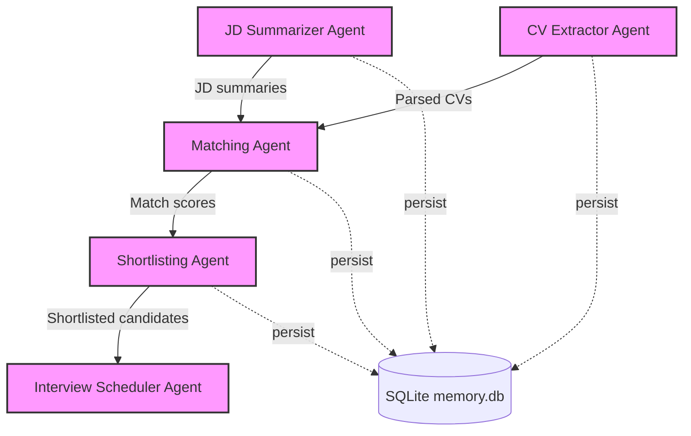

# Praxiator

**A Multi-Agent AI Recruitment Intelligence System**


Praxiator automates first-round resume screening. It parses job descriptions and PDF resumes, scores every candidate against every role using semantic embeddings, shortlists the best matches, and drafts personalized interview invitations. Everything runs locally with Ollama, so no API keys and no candidate data leaving your machine.

Built for a GenAI hackathon.

<!-- Add a screenshot of the Streamlit dashboard here:  -->

## Table of Contents

- [Overview](#overview)
- [Architecture](#architecture)
- [Project Structure](#project-structure)
- [Getting Started](#getting-started)
- [Usage](#usage)
- [Configuration](#configuration)
- [Sample Results](#sample-results)
- [Database Schema](#database-schema)
- [Testing](#testing)
- [Troubleshooting](#troubleshooting)
- [Limitations & Future Work](#limitations--future-work)
- [License](#license)

## Overview

Manual resume screening is slow and inconsistent. Praxiator splits the workflow into five single-purpose agents that hand data to each other in a pipeline, with every step persisted to SQLite so runs are inspectable afterward.

| Agent | File | Responsibility |
|---|---|---|
| JD Summarizer | `agents/jd_summarizer.py` | Loads job descriptions from CSV and extracts required skills, experience, education, certifications, and responsibilities |
| CV Extractor | `agents/cv_extractor.py` | Reads PDF resumes with PyMuPDF and extracts name, email, phone, education, experience, skills, certifications, and tech stack |
| Matcher | `agents/matcher.py` | Embeds each JD and CV with `nomic-embed-text` and scores them by cosine similarity (0 to 100) |
| Shortlister | `agents/shortlister.py` | Keeps candidates at or above a configurable score threshold (default 80) |
| Interview Scheduler | `agents/emailer.py` | Generates personalized invitation emails that highlight skills matching the job, and sends them via SMTP or simulates sending |

You can drive the pipeline from the command line (`main.py`) or from a Streamlit dashboard (`app.py`).

## Architecture



**How a run works**

1. The JD Summarizer reads `job_description.csv` and produces a structured summary per role.
2. The CV Extractor parses every PDF in `resumes/`.
3. The Matcher builds a text representation of each JD and CV, embeds both through Ollama, and computes cosine similarity for every JD and CV pair.
4. The Shortlister filters each role's ranked list by the threshold.
5. The Interview Scheduler writes a personalized email per shortlisted candidate. It is simulated unless real sending is enabled (see [Configuration](#configuration)).
6. All results are stored in SQLite, and an agent diagram is generated.

## Project Structure

```
.
├── main.py                  # CLI entry point: runs the full pipeline
├── app.py                   # Streamlit dashboard
├── demo.py                  # Lightweight demo with mock processing (no Ollama needed)
├── agents/
│   ├── jd_summarizer.py     # Job description parsing
│   ├── cv_extractor.py      # PDF resume extraction
│   ├── matcher.py           # Embedding-based matching
│   ├── shortlister.py       # Threshold-based shortlisting
│   └── emailer.py           # Email generation and sending
├── utils/
│   ├── embeddings.py        # Cached Ollama embeddings + cosine similarity
│   ├── skills.py            # Shared technology vocabulary
│   ├── parser.py            # Text parsing helpers
│   └── diagram.py           # Mermaid / matplotlib diagram generator
├── db/
│   └── memory.py            # Thread-safe SQLite persistence layer
├── resumes/                 # 200 synthetic sample resumes (PDF)
├── job_description.csv      # 20 sample job descriptions
├── tests/                   # pytest suite (Ollama is mocked, so it runs anywhere)
├── scripts/
│   └── check_ollama_chat.py # Manual check that a local chat model responds
├── .github/workflows/       # CI: runs the tests on every push
├── agent_diagram.md / .png  # Generated agent interaction diagrams
├── SUMMARY.md               # Project summary
└── requirements.txt
```

## Getting Started

### Prerequisites

- Python 3.10+
- [Ollama](https://ollama.ai/) installed **and running** locally

### Installation

1. Clone the repository:
   ```bash
   git clone https://github.com/Prachibagasi/Praxiator-A-Multi-Agent-AI-Recruitment-Intelligence-System.git
   cd Praxiator-A-Multi-Agent-AI-Recruitment-Intelligence-System
   ```

2. Create and activate a virtual environment:
   ```bash
   python -m venv venv
   source venv/bin/activate   # On Windows: venv\Scripts\activate
   ```

3. Install dependencies:
   ```bash
   pip install -r requirements.txt
   ```

4. Pull the models:
   ```bash
   ollama pull nomic-embed-text   # embeddings (required)
   ollama pull llama3             # structured JD extraction (optional; rules are used without it)
   ```

5. Confirm Ollama is running and the models are available:
   ```bash
   ollama list
   ```

## Usage

### Run the full pipeline (CLI)

```bash
python main.py
```

With options:

```bash
python main.py --jd-file path/to/jds.csv --resumes-dir path/to/resumes --threshold 85 --send-emails
```

| Argument | Default | Description |
|---|---|---|
| `--jd-file` | `job_description.csv` | Path to the job descriptions CSV |
| `--resumes-dir` | `resumes` | Directory containing resume PDFs |
| `--db-file` | `memory.db` | SQLite database path |
| `--threshold` | `80.0` | Minimum match score (0 to 100) for shortlisting |
| `--send-emails` | off | Run the Interview Scheduler step (simulated unless `--live`) |
| `--live` | off | Actually send emails via SMTP; requires `--send-emails` and the SMTP variables below |
| `--top-n` | none | Shortlist at most N candidates per job (the best scores above the threshold) |
| `--skill-weight` | `0.0` | 0 to 1: share of the score from explicit technology overlap between JD and CV. `0` = embeddings only |
| `--diagram-type` | `mermaid` | Diagram output: `mermaid` or `matplotlib` |

Emails are only sent when you pass `--live`. In live mode the shortlist table records `email_sent` and the date for each candidate. If Ollama isn't reachable, the run stops immediately with a clear message and writes nothing.

### Launch the dashboard

```bash
streamlit run app.py
```

| Page | What it does |
|---|---|
| Home | Overview and one-click full pipeline run |
| Job Descriptions | Process and inspect parsed job descriptions |
| Resumes | Process and inspect extracted resume data |
| Matching | Run matching and view scores |
| Shortlisting | View shortlisted candidates (threshold slider: 50 to 100) |
| Emails | Preview, simulate, or send interview invitations |
| Database | Browse the SQLite tables |
| About | Architecture and technical details |

The sidebar lets you change the database file, JD file, resumes directory, match threshold, and whether emails are simulated.

### Try it without Ollama

`demo.py` simulates the full flow with mock processing, which is useful for a quick walkthrough:

```bash
python demo.py
```

## Configuration

Email sending is **simulated by default**. To send real emails, set your SMTP details as environment variables, then use `--live` on the CLI or uncheck **Simulate emails** in the dashboard sidebar. Live mode refuses to start if the credentials are missing:

```bash
export SMTP_SERVER=smtp.gmail.com     # default
export SMTP_PORT=587                  # default
export SENDER_EMAIL=you@example.com
export EMAIL_PASSWORD=your-app-password
```

Optional model settings:

```bash
export OLLAMA_EMBED_MODEL=nomic-embed-text   # embedding model (default)
export OLLAMA_CHAT_MODEL=llama3              # model for JD extraction (default)
export EMBEDDING_CACHE=embedding_cache.db    # on-disk embedding cache; set to "" to disable
```

For Gmail, use an [app password](https://support.google.com/accounts/answer/185833), not your account password. Credentials are read from the environment only, so never commit them. The repo's `.gitignore` already excludes `.env` files.

## Sample Results

From an earlier run over the bundled data (20 job descriptions × 200 resumes = 4,000 scored pairs, embeddings only). Re-run the pipeline to refresh these after pulling the latest changes:

| Metric | Value |
|---|---|
| Score range | 59.6 to 83.3 |
| Mean score | 69.5 |
| Pairs at or above the 80 threshold | 28 (0.7%) |

Embedding similarity scores cluster in a narrow band, so the threshold has a large effect on how many candidates are shortlisted. Tune `--threshold` (or the dashboard slider) to your data rather than treating 80 as meaningful on its own.

## Database Schema

Persistence lives in `db/memory.py` (SQLite, one connection per thread):

| Table | Stores |
|---|---|
| `jd_summaries` | Parsed job descriptions |
| `cv_data` | Extracted resume data |
| `match_scores` | Score for each JD and CV pair |
| `shortlist` | Shortlisted candidates and email status |

## Testing

```bash
pip install -r requirements-dev.txt
pytest
```

The suite mocks Ollama, so it needs no running services. It covers resume parsing (including all 200 bundled resumes), embedding caching and failure handling, matching and the hybrid score, shortlisting, email generation and SMTP sending, database upserts and thread safety, and full end-to-end CLI runs. GitHub Actions runs it on every push.

`scripts/check_ollama_chat.py` is a manual check that a local chat model responds.

## Troubleshooting

**"Could not get an embedding from Ollama".** Ollama isn't running or the embedding model isn't pulled. Start Ollama and run `ollama pull nomic-embed-text`. The pipeline stops instead of producing scores from missing data.

**"LLM extraction unavailable".** The chat model for JD parsing isn't installed. Run `ollama pull llama3` or set `OLLAMA_CHAT_MODEL`. Rule-based extraction is used in the meantime.

**First run is slow, later runs are fast.** Each unique JD and resume is embedded once and cached in `embedding_cache.db`. Delete that file to force re-embedding (for example after switching embedding models, which is cached separately anyway).

**"no extractable text" warning for a resume.** It's probably a scanned PDF. Install [Tesseract](https://github.com/tesseract-ocr/tesseract) and PyMuPDF will use OCR automatically.

**A resume shows `Unknown` as the name.** The parser looks for a `Name:` line, then for a name-like line near the top. Unusual layouts may need a tweak in `_extract_name`.

## Limitations & Future Work

- **Scores are a ranking signal, not a verdict.** Embedding similarity measures topical closeness, not qualification, and scores cluster in a narrow band. Use `--top-n` for relative cut-offs, `--skill-weight` to blend in explicit technology overlap (re-tune the threshold afterwards, since blended scores sit on a different scale), and keep a human in the loop.
- **Resume parsing is rule-based.** It handles standard headings (`Education`, `Work Experience`, `Skills`, ...) and falls back to looser patterns, but heavily designed resumes may parse poorly. Scanned PDFs need Tesseract for OCR (untested on the bundled data, which is all text-based).
- **JD extraction needs a pulled chat model** (default `llama3`); otherwise it uses regex rules.
- **PDF only.** DOCX resumes are not supported yet.

Ideas for next steps:

- DOCX resume support
- Evaluate scoring against labeled hiring outcomes instead of treating similarity as truth
- Configurable weights for skills vs. experience vs. education
- Integration with applicant tracking systems

## Data & Privacy

The bundled resumes in `resumes/` are synthetic samples. Do not commit real candidate resumes or a populated database to a public repository, since resumes contain personal data.

## License

Released under the MIT License.

## Author

**Prachi Bagasi** · [@Prachibagasi](https://github.com/Prachibagasi)
